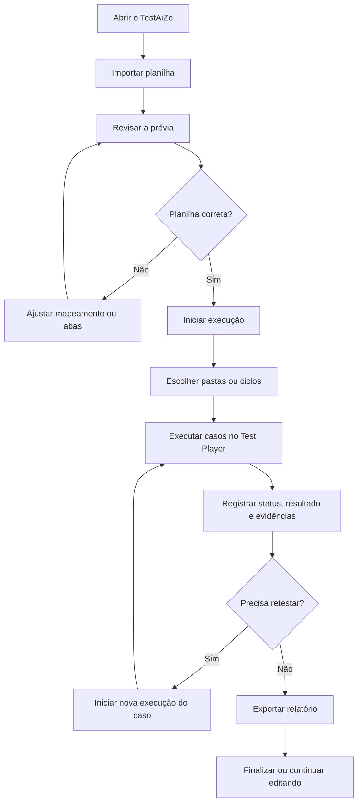

# Manual do TestAiZe

O TestAiZe é um executor local de testes manuais. Você importa os casos de teste de uma planilha, executa cada passo no Test Player, registra resultados e evidências e gera um relatório para compartilhar.

Este manual mostra o fluxo completo de uso, do primeiro acesso ao relatório final.

## Fluxo completo



## 1. Antes de começar

Você precisa de:

- Windows 10 ou 11;
- o executável do TestAiZe;
- uma planilha de casos em `.xlsx` ou CSV UTF-8;
- Microsoft Edge ou Google Chrome instalado, caso queira gerar PDF.

Os casos manuais entram no sistema por meio da planilha. A criação manual de novos casos dentro do aplicativo ainda não está disponível.

## 2. Abrir o aplicativo

1. Baixe o artefato `TestAiZe-windows-01.005.000` na aba [Actions](https://github.com/devphpaulo/TestAiZe/actions).
2. Descompacte o arquivo em qualquer pasta.
3. Dê dois cliques em `TestAiZe-01.005.000.exe`.
4. O aplicativo abrirá no navegador e ficará disponível na bandeja do Windows.

O executável não precisa de instalação. Também não é necessário manter uma janela de terminal aberta.

Pelo ícone na bandeja, você pode:

- **Abrir aplicativo**: abrir novamente a tela no navegador;
- **Abrir pasta de dados**: acessar os arquivos salvos;
- **Encerrar aplicativo**: fechar o TestAiZe.

Se o aplicativo já estiver aberto, abrir o executável novamente apenas reabre o navegador.

## 3. Criar uma execução a partir da planilha

Na tela inicial:

1. Clique em **Escolher arquivo**.
2. Selecione um arquivo `.xlsx` ou CSV UTF-8.
3. Clique em **Ver prévia**.
4. Confira as abas, os casos, os passos e o mapeamento das colunas.
5. Se necessário, ajuste o mapeamento manualmente.
6. Selecione somente as abas que deseja importar.
7. Corrija os erros exibidos na prévia.
8. Clique em **Iniciar execução**.

Quando a execução for criada, os casos aparecerão no Test Player.

### Formato esperado da planilha

O layout padrão possui estes campos:

| Campo | Para que serve |
|---|---|
| Nome | Nome do caso de teste |
| Precondição | O que precisa estar preparado antes do teste |
| Status | Situação inicial do caso |
| Prioridade | Importância do caso |
| Passo | Ação que deve ser executada |
| Resultado Esperado | Comportamento esperado após o passo |
| Dados do teste | Massa, caminho ou informação usada no teste |
| Pasta | Agrupamento do caso ou ciclo |

Cada passo ocupa uma linha. Os dados do caso, como nome, precondição, status, prioridade e pasta, devem ser preenchidos somente na primeira linha daquele caso.

O modelo completo está em [docs/planilha.md](planilha.md).

## 4. Escolher o que executar

Ao abrir uma execução, você pode:

- abrir **Todas as pastas**;
- abrir uma pasta específica;
- filtrar vários ciclos;
- buscar um caso ou uma pasta;
- visualizar o progresso por status;
- alternar para o **Modo Kanban**.

Use pastas para concentrar a execução em uma funcionalidade, card, produto ou conjunto de cenários.

## 5. Executar um caso no Test Player

Para cada caso:

1. Leia a precondição e os passos.
2. Execute a ação descrita no sistema que está sendo testado.
3. Registre o resultado observado.
4. Marque o status do passo.
5. Adicione evidências quando necessário.
6. Revise o status final do caso.

### Status disponíveis

| Status | Quando usar |
|---|---|
| **Não executado** | O passo ou caso ainda não foi avaliado |
| **Em andamento** | A execução começou, mas ainda não terminou |
| **Bloqueado** | Não foi possível executar por uma dependência ou impedimento |
| **Reprovado** | O resultado observado não corresponde ao esperado |
| **Aprovado** | O comportamento observado corresponde ao esperado |

O status do caso pode ser definido diretamente pelos botões de status. Para voltar ao cálculo automático com base nos passos, use **Automático pelos passos**.

A data e a hora da alteração de status ficam registradas no caso e aparecem também no relatório.

## 6. Registrar resultado e evidências

O campo **Pré-condições da planilha** é apenas informativo. Para registrar o que aconteceu durante a execução, use:

- **Resultado observado**: descreva o comportamento encontrado;
- **Anotações e evidências**: registre informações complementares;
- **Comentário do caso**: anote uma conclusão ou observação geral.

### Colar imagens

Nos campos editáveis:

1. Copie uma imagem.
2. Posicione o cursor no campo desejado.
3. Pressione `Ctrl+V`.
4. Use Enter para continuar o texto abaixo da imagem.
5. Use Backspace logo depois da imagem para removê-la, quando necessário.

Também é possível ajustar visualmente a largura da imagem arrastando seu canto inferior direito.

As imagens permanecem vinculadas à execução e aparecem no PDF e no HTML.

### Anexar arquivos

Use **Anexar arquivos** no passo para adicionar arquivos como:

- TXT;
- XLS;
- XML;
- JPG;
- PNG;
- outros arquivos relacionados ao teste.

Limites:

- até 5 arquivos por passo;
- até 5 MB por arquivo.

Os anexos ficam separados das imagens coladas. Eles podem ser baixados ou removidos no Test Player.

No PDF, os anexos aparecem listados com nome, extensão e tamanho. No HTML, cada anexo possui a opção **Baixar anexo**.

## 7. Retestar um caso

Quando um caso falhar ou precisar ser executado novamente:

1. Vá até o final do caso.
2. Clique em **Iniciar nova execução deste caso**.
3. Faça o reteste.
4. Registre novos status, resultados e evidências.

A execução anterior não é apagada. Ela fica em **Execuções anteriores**, com:

- status;
- passos;
- horários;
- anotações;
- imagens;
- arquivos anexados.

O PDF pode ser gerado usando somente a execução atual. O histórico continua disponível dentro da sessão.

## 8. Gerar um relatório

Clique em **Exportar Relatório** em qualquer momento da execução. Não é necessário finalizar antes.

No modal:

1. Escolha **PDF** ou **HTML**.
2. Selecione os casos ou pastas desejados.
3. Escolha uma opção:
   - **Somente a última**: inclui apenas a execução atual de cada caso;
   - **Todas as execuções**: inclui também os retestes anteriores.
4. Confirme a exportação.

### PDF

O PDF inclui:

- resumo da execução;
- distribuição dos resultados;
- casos selecionados;
- passos;
- resultados observados;
- comentários;
- imagens;
- lista de arquivos anexados.

Os anexos são listados no PDF, mas seus arquivos não são incorporados.

### HTML

O HTML inclui os mesmos dados e permite:

- baixar os anexos;
- mostrar todos os casos;
- focar em um caso específico;
- enviar o relatório como um arquivo único.

O último PDF fica em:

`Documentos/TestAiZe/<execução>/relatorios/relatorio.pdf`

O último HTML fica em:

`Documentos/TestAiZe/<execução>/relatorios/relatorio.html`

## 9. Gerar relatório de falha e prompt de bug

Quando o caso e pelo menos um de seus passos estiverem como **Reprovado**, o Test Player disponibiliza:

- **Gerar relatório da falha**;
- **Copiar prompt de bug**.

O relatório de falha contém somente a execução atual daquele caso.

O texto copiado usa o arquivo `prompt-report-bug.txt`, localizado na pasta de dados do aplicativo. Esse arquivo pode ser personalizado em UTF-8.

O marcador:

`{{DADOS_DO_CASO}}`

é substituído automaticamente pelos dados do caso, resultados observados e nomes das evidências.

## 10. Finalizar e retomar uma execução

Você pode exportar um relatório sem finalizar a execução.

Quando o trabalho estiver concluído:

1. Clique em **Finalizar execução**.
2. A execução será movida para o histórico de sessões.
3. Ela continuará disponível para consulta e edição.

Mesmo finalizada, a sessão pode receber ajustes de status, anotações, evidências e novos retestes.

## 11. Onde os dados ficam

O TestAiZe salva os dados em:

`Documentos/TestAiZe`

A pasta contém, entre outros itens:

- `rascunhos/`: execuções ainda não finalizadas;
- `sessoes/`: execuções finalizadas;
- `excluidas/`: sessões retiradas da lista;
- `relatorios/`: relatórios gerados;
- imagens e anexos;
- backups;
- `logs/aplicativo.log`: registros de funcionamento.

O caminho exato pode variar conforme a configuração do Windows e do OneDrive. Use **Abrir pasta de dados** na bandeja para acessar a localização correta.

## 12. Fazer backup

Para criar uma cópia dos seus dados:

1. Encerre o TestAiZe pela bandeja do Windows.
2. Copie a pasta inteira **TestAiZe** para outro local.
3. Guarde a cópia em um disco, servidor ou serviço de armazenamento confiável.

Para restaurar:

1. Encerre o aplicativo.
2. Substitua a pasta de dados pela cópia de segurança.
3. Abra o TestAiZe novamente.

Não copie ou substitua os arquivos enquanto o aplicativo estiver aberto.

## 13. Excluir uma sessão

Na lista de sessões, clique em **Excluir** e escolha uma opção:

- **Não, guardar os arquivos**: remove a sessão da lista e move seus arquivos para `excluidas/`;
- **Sim, excluir também os arquivos**: apaga permanentemente a sessão, suas evidências e seus relatórios.

A exclusão permanente não deve ser usada antes de confirmar que existe uma cópia de segurança.

## 14. Solução rápida de problemas

### O PDF não foi gerado

Verifique se o Microsoft Edge ou Google Chrome está instalado. O TestAiZe utiliza um desses navegadores para renderizar o PDF.

### O aplicativo parece já estar aberto

Dê dois cliques no executável novamente. Se a instância já estiver em execução, o navegador será reaberto.

### A planilha não aparece corretamente

Confira se:

- o arquivo é `.xlsx` ou CSV UTF-8;
- a primeira linha contém os cabeçalhos;
- cada caso está organizado em várias linhas, uma por passo;
- o mapeamento foi revisado na prévia;
- não existem erros nas abas selecionadas.

### Uma imagem não aparece

A versão atual aceita imagens PNG, JPEG ou WebP de até 10 MB e 40 megapixels. Imagens incorporadas dentro da planilha não são importadas automaticamente.

### Não encontro uma sessão

Use **Abrir pasta de dados** na bandeja e verifique as pastas `rascunhos/`, `sessoes/` e `excluidas/`.

## Limitações atuais

- os casos manuais precisam ser importados por planilha;
- a criação manual de casos ainda não está disponível;
- apenas um operador deve usar a mesma instalação por vez;
- imagens incorporadas na planilha não são importadas;
- cada seção de evidências aceita até 12 imagens;
- cada imagem pode ter até 10 MB e 40 megapixels;
- cada passo aceita até 5 anexos de até 5 MB cada.

## Executar pelo código-fonte

Esta opção é destinada a quem deseja executar o projeto diretamente pelo Python.

Requisitos:

- Python 3.12 ou superior;
- `pip`.

Com o repositório clonado:

```bash
pip install -r requirements.txt
python launcher.py
```

O aplicativo continuará funcionando localmente e abrirá o Test Player no navegador.
